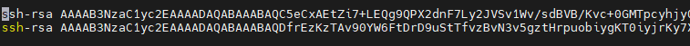
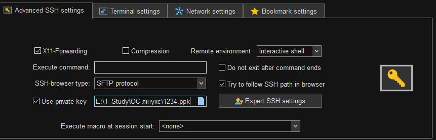
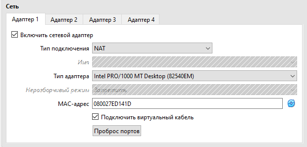
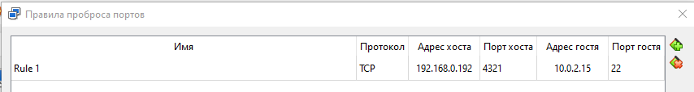
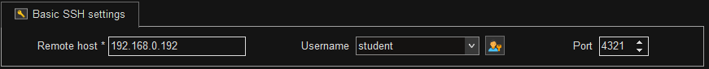
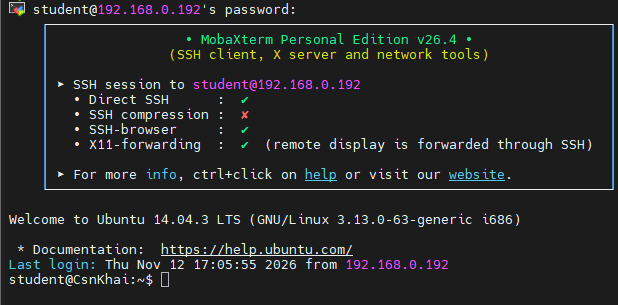
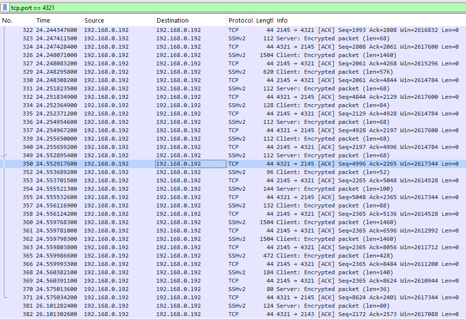

# Report on Lab_5

## Завдання на лабороторну 5

---

### 1. Перевірте можливість виконання найпоширеніших команд **OpenSSH** в операційній системі **MS Windows**. (Перелік команд + опис очікуваного результату + скріншоти: команда – результат).

Для пеервірки спочатку ми перевіремо чи взагалі є OpenSSH де у результаті У терміналі відображається поточна версія клієнта OpenSSH та бібліотеки OpenSSL

```
student@CsnKhai:~$ ssh -V
OpenSSH_6.6.1p1 Ubuntu-2ubuntu2.3, OpenSSL 1.0.1f 6 Jan 2014
```

Після згенеруємо ключі де після команди у виводі з'являється унікальний цифровий відбиток ключа (fingerprint) та його графічне подання

```
student@CsnKhai:~$ ssh-keygen
Generating public/private rsa key pair.
Enter file in which to save the key (/home/student/.ssh/id_rsa):
/home/student/.ssh/id_rsa already exists.
Overwrite (y/n)? y
Enter passphrase (empty for no passphrase):
Enter same passphrase again:
Your identification has been saved in /home/student/.ssh/id_rsa.
Your public key has been saved in /home/student/.ssh/id_rsa.pub.
The key fingerprint is:
70:c7:a7:41:2c:85:c6:2a:f6:26:bd:f5:3a:6d:3a:43 student@CsnKhai
The key's randomart image is:
+--[ RSA 2048]----+
|       . +o      |
|        =o.      |
|      .o..+ .    |
|    o .o . +     |
|   . +  S .      |
|    . + E        |
|     o + o       |
|      . + +      |
|        oB       |
+-----------------+
```

Тепер скопіюємо публічний ключ на віддалений сервер де після одноразового введення пароля користувача student від віддаленого сервера, утиліта автоматично додає вміст файлу id_rsa.pub до файлу ~/.ssh/authorized_keys на сервері 192.168.0.193

```
student@CsnKhai:~$ ssh-copy-id -p 2202  student@192.168.0.193
/usr/bin/ssh-copy-id: INFO: attempting to log in with the new key(s), to filter out any that are already installed
/usr/bin/ssh-copy-id: INFO: 1 key(s) remain to be installed -- if you are prompted now it is to install the new keys
student@192.168.0.193's password:

Number of key(s) added: 1

Now try logging into the machine, with:   "ssh -p '2202' 'student@192.168.0.193'"
and check to make sure that only the key(s) you wanted were added.

```

І підключимося до відаленого серверу через ssh з'єднання у результаті виконання команди ми отримаємо підключення до сервера 192.168.0.193 через порт 2202

```
student@CsnKhai:~$ ssh -p 2202  student@192.168.0.193
Welcome to Ubuntu 14.04.3 LTS (GNU/Linux 3.13.0-63-generic i686)

 * Documentation:  https://help.ubuntu.com/
Last login: Thu Nov 12 17:12:09 2026 from 192.168.0.192
student@CsnKhai:~$

```

---

### 2. Налаштуйте базові параметри SSH для підвищення безпеки з'єднання між клієнтом та сервером (щонайменше 3 параметри).

Для підвищення безпеки з'єднання між клієнтом та сервером викорисатаємо наступні методи:

Зміна порту SSH з 22 на 2202 для того щоб перейти з базового порту лінукс  на інший. Для цього нам необхідно змінити файл /etc/ssh/sshd_config

```
student@CsnKhai:~$ sudo nano /etc/ssh/sshd_config
```

У самому файлі змінюємо рядок

```
# Package generated configuration file
# See the sshd_config(5) manpage for details

# What ports, IPs and protocols we listen for
Port 2202
```

Після цього перезапускаємо службу SSH

```
student@CsnKhai:~$ sudo service ssh restart
ssh stop/waiting
ssh start/running, process 10419
```

тепер порт підключення є 2202

Далі у тому ж файлі робимо заборону на логін рутом

```
# Authentication:
LoginGraceTime 120
PermitRootLogin no
StrictModes yes
AllowUsers student
```

також встановлено AllowUsers student щоб можливо було підключитися тльки за логіном student

останім налаштуваням параметрів буде відключення з’єднання за логіном/паролем

проте перед цим необхідно зробити ключі ssh з MobaXterm бо якщо це не зробити до неї не вийде під'єднатися таким чином.

спочатку генеруемо у MobaXterm ключ ssh і записуемо публічний ключ за допомогою nano ~/.ssh/authorized_keys



після у налаштуваннях ез'еднання у MobaXterm обираємо приватний ключ



Після цього у файлі /etc/ssh/sshd_config зімнюємо PasswordAuthentication на no та змінемо коментування

```
# Change to no to disable tunnelled clear text passwords
PasswordAuthentication no
```

Після цього перезапускаємо службу SSH


після усіх цих дій підколючення стане можливим тільки при використанні цього ssh ключа а в інших випадках підключення буде ігноруватися вже на єтапі півля введення логіну а у разі не того порту ще на підключенні.

---

### 3. Перелічіть варіанти вибору ключів шифрування в SSH. Реалізуйте 3 з них (згенеруйте 3 різні типи ключів).

у SSH існує  такі варіанти ключів шифрування як:

Ed25519 - сучасний стандарт. Найшвидший, найстійкіший до злому та генерує дуже короткі ключі.

RSA  - класичний стандарт. Найбільш сумісний зі старими серверами та обладнанням; рекомендована довжина — не менше 4096 біт.

ECDSA - використовує еліптичні криві NIST. Швидший за RSA, але поступається Ed25519 у криптостійкості.

DSA - застарілий та небезпечний. Вважається криптографічно слабким і вимкнений за замовчуванням у сучасних версіях OpenSSH.

Ed25519-SK / ECDSA-SK  - варіанти з підтримкою фізичних апаратних ключів безпеки.

Тепер згенеруємо 3 різних типи ключів а саме:

Ed25519

```
student@CsnKhai:~$ ssh-keygen -t ed25519 -f ~/.ssh/key_ed25519 -C "student_ed25519"
Generating public/private ed25519 key pair.
Enter passphrase (empty for no passphrase):
Enter same passphrase again:
Your identification has been saved in /home/student/.ssh/key_ed25519.
Your public key has been saved in /home/student/.ssh/key_ed25519.pub.
The key fingerprint is:
80:bb:1f:8b:49:ec:55:f0:d4:2c:c7:e0:2d:9e:26:34 student_ed25519
The key's randomart image is:
+--[ED25519  256--+
|        .        |
|     . . *       |
|    . E = *      |
|     o B =       |
|    . . S        |
|   . . +         |
|    + o          |
|   o = o         |
|    + o          |
+-----------------+
```

RSA

```
student@CsnKhai:~$ ssh-keygen -t rsa -b 4096 -f ~/.ssh/key_rsa -C "student_rsa"
Generating public/private rsa key pair.


Enter passphrase (empty for no passphrase):
Enter same passphrase again:
Your identification has been saved in /home/student/.ssh/key_rsa.
Your public key has been saved in /home/student/.ssh/key_rsa.pub.
The key fingerprint is:
43:c8:da:27:57:a9:35:3d:2e:a0:03:38:53:70:0a:e9 student_rsa
The key's randomart image is:
+--[ RSA 4096]----+
|....o            |
|.. = . .   o     |
|. = . o o = o    |
| E o + o = o .   |
|    . = S . .    |
|       = . .     |
|                 |
|                 |
|                 |
+-----------------+
```

та ECDSA

```
student@CsnKhai:~$ ssh-keygen -t ecdsa -b 521 -f ~/.ssh/key_ecdsa -C "student_ecdsa"
Generating public/private ecdsa key pair.
Enter passphrase (empty for no passphrase):
Enter same passphrase again:
Your identification has been saved in /home/student/.ssh/key_ecdsa.
Your public key has been saved in /home/student/.ssh/key_ecdsa.pub.
The key fingerprint is:
af:05:92:b4:3d:dc:c6:37:01:41:72:83:7b:cc:07:5b student_ecdsa
The key's randomart image is:
+--[ECDSA  521]---+
|        .o*.     |
|        .o.oE    |
|      .  + +.    |
|     . =.o= ..   |
|      + S.+.o    |
|       . = . .   |
|          o      |
|         o       |
|        .        |
+-----------------+
```

---

### 4. Налаштуйте прокидання портів (port forwarding) для SSH-клієнта з хост-машини на гостьову віртуальну машину Linux, яка знаходиться за NAT.

для прокидання портів  з хост-машини на гостьову віртуальну машину Linux за нат необхідно спочатку дізнатися адреси обох машин після чого зайти у налаштування віртуальної машини та змінити тип з'єдання на NAT:



після цього написнути на кнопку прокинути порти та заповнити таблицю де адреса хоста це адреса хост машини порт хоста заповлюєтся будь який адреса гостя це адреса віртуальної машини та порт гостя це порт через який йде підключення до убунту



після цього після налаштування у MobaXterm підключення на порт та адресу хосту нас буде підключати до віртуальної системи






---
        
### 5*. Перехопіть (захопіть) трафік (за допомогою **tcpdump** або **Wireshark**) під час авторизації віддаленого клієнта на сервері через **SSH**, **Telnet** та **Rlogin**. Проаналізуйте отриманий результат.

для перехоплення трафіку було використано Wireshark де після заходу у MobaXterm до віртуальної машини через NAT було отримано такий результат



для аналізу було обрано пакет під номером 350 де

Номер пакету у потоці: 350 (час захоплення 24.552917600 секунд від початку сесії).

Розмір: 44 байти на проводі (352 біти), 44 байти захоплено. Це службовий пакет транспортного рівня.

Мережеві адреси: Передача пакету здійснюється всередині петельки (\Device\NPF_Loopback) між адресами Source: 192.168.0.192 та Destination: 192.168.0.192.

Аналіз транспортного рівня (TCP):

Порт джерела (Source Port): 4321 (динамічний порт клієнтського підключення).

Порт призначення (Destination Port): 2145 (наш прокинутий порт у середовищі віртуалізації, на якому слухає SSH-сервер).

Порядкові номери та керуючі прапорці:

Sequence Number (raw): 2264940967 (відносний номер 4996).

Acknowledgment Number (raw): 3574651970 (відносний номер 2265).

У колонці Info та деталях пакету зафіксовано прапорець [ACK] (Acknowledgment, Flags: 0x010), який підтверджує успішне отримання попередньої порції даних (довжина корисного навантаження TCP Segment Len: 0).

Аналіз вмісту та шифрування (Hex / Payload):

У правій панелі у шістнадцятковому (Hex) та ASCII-форматі відображено вміст сирих байтів пакету (початкові байти заголовків 02 00 00 00 45 00 00 28...).

У цьому та сусідніх перехоплених пакетах протоколу SSHv2 (наприклад, пакети 349 та 352 з позначкою Encrypted packet) корисне навантаження є зашифрованим бінарним потоком. Тут повністю відсутні будь-які відкриті текстові дані — немає ні імен користувачів, ні паролів, ні введених у консолі команд (таких як pwd чи ls).

Протокол Telnet на відміну від зашифрованого SSHv2 передає весь трафік відкритим текстом. Під час аналізу у Wireshark або tcpdump вільно читаються запити входу, логін, посимвольно переданий пароль та всі введені команди, що робить сеанс повністю вразливим до перехоплення.

Протокол Rlogin  також не використовує шифрування, відкрито передаючи імена користувачів, тип термінала та пароль одразу після з'єднання. Крім того, він покладається на небезпечну автентифікацію за IP-адресами, через що вразливий не лише до перехоплення паролів, а й до підміни IP.